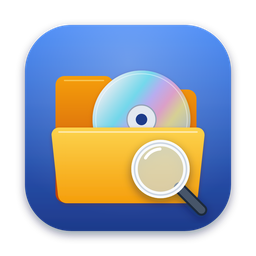
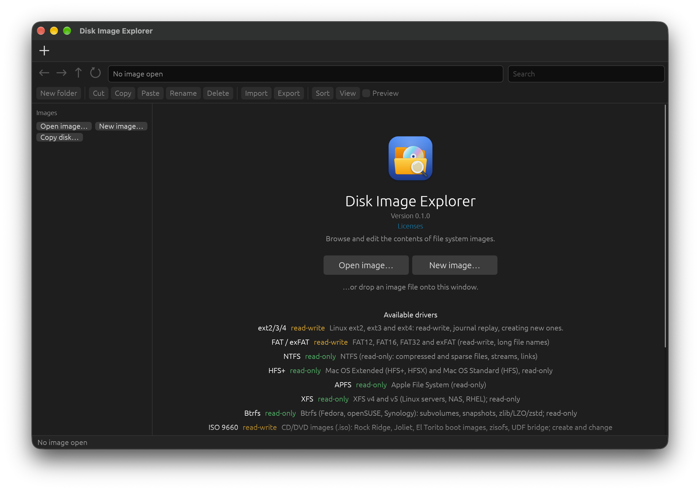

# Disk Image Explorer



Browse disk images, file systems and archives in a familiar file explorer.
Preview and extract files, copy between images, and edit formats that support
writing—without mounting them in your operating system.

Built in Rust with [egui](https://github.com/emilk/egui). Runs on **macOS,
Windows and Linux**, and in the **browser with WebAssembly**.



## What you can do

- Browse with tabs, a folder tree, file previews and a hex viewer. Search by
  file name or contents.
- Copy files between images and your computer; create folders, rename and
  delete files in writable formats.
- Open raw disks, partitions, virtual machine disks, compressed images and
  split archives. Open images nested inside other images or archives.
- Create and convert disk images, edit partition tables, and check or repair
  supported file systems.
- Recover deleted files, scan for photos and videos, and find lost partitions.
- Save a physical disk to an image or write an image to a disk, with verification
  and a rescue mode for failing disks.

Choose **read-only** or **read-write** when opening an image. Available actions
follow the format's capabilities. In the browser, images are uploaded into
memory and can be downloaded after editing; physical disk access is native only.

## Supported formats

| Formats | Support |
|---------|---------|
| ext2, ext3, ext4 | Read, write, create, journal replay and check/repair |
| FAT12/16/32, exFAT | Read, write, create and check/repair |
| NTFS | Read, check and deleted-file recovery |
| HFS, HFS+, HFSX, APFS | Read, including supported macOS compression |
| XFS, Btrfs, SquashFS | Read |
| ISO 9660, UDF | Read, create and edit supported image layouts |
| littlefs v2 | Read, write and create |
| ZIP, tar, cpio, 7z | Read, write and create; supported compression and encryption vary |
| RAR, ARJ, ar, CAB, XAR, DEB, RPM, PKG and self-extracting archives | Read |
| Split archives and numbered file parts | Read |
| qcow2, VHD, VHDX, VMDK, VDI | Read, create and write supported variants; convert between formats |
| Apple disk images (DMG) | Read, create, edit and convert supported UDIF images |
| SimpleFS | Read, write and create; a small format for testing |

Support depends on a format's features and image layout. The
[format reference](docs/formats.md) covers individual variants, codecs,
limitations, recovery and disk-copy operations.

## Download and run

Download an available build for your platform from
[GitHub Releases](https://github.com/ozkl/dix/releases), or build from source below.

### macOS

After downloading a release, extract it or open the DMG and copy
**Disk Image Explorer.app** into **Applications**. If macOS blocks the downloaded
app because it is not notarized, remove its quarantine attribute after verifying
that you downloaded it from this project's releases:

```bash
xattr -dr com.apple.quarantine "/Applications/Disk Image Explorer.app"
```

Then open the app normally. If you put it elsewhere, adjust the path.

Accessing raw disks requires administrator/root rights: `sudo` on macOS/Linux,
or **Run as administrator** on Windows. Ordinary image files do not need this.

## Building

Install Rust and Cargo, then run these commands from the repository root:

```bash
cargo run --release -p dix-app
# Open an image read-only on startup:
cargo run --release -p dix-app -- disk.img
# Run the tests:
cargo test
```

Linux needs the usual egui/winit system libraries for X11 or Wayland and OpenGL.

To build a macOS app bundle:

```bash
scripts/macos-bundle.sh
# Output: target/macos/Disk Image Explorer.app
```

For the web build, install [Trunk](https://trunkrs.dev), then:

```bash
rustup target add wasm32-unknown-unknown
cd crates/dix-app
trunk serve --release
# Or: trunk build --release (output: ../../dist)
```

See the [build guide](docs/building.md) for universal macOS bundles, DMGs,
Windows cross-compilation, sample images, optional drivers and codecs.

## Documentation

The detailed project documentation lives in `docs/`. For contributors and
coding agents, start with the architecture and then the relevant format section.

- [Features and usage](docs/features.md): UI behavior, image operations and workflows.
- [Building and packaging](docs/building.md): build options, Cargo features, icons and license generation.
- [Architecture and development](docs/architecture.md): crate boundaries, driver interfaces, background jobs, crash testing and roadmap.
- [Format reference](docs/formats.md): driver capabilities, implementation details, limitations and test coverage.

## License

[MIT](LICENSE). The ext4 driver includes code adapted from
[ruxis](https://github.com/ozkl/ruxis), with its attribution preserved.
[Third-party licenses](THIRD-PARTY-LICENSES.txt) are included in the app;
see the [licensing notes](docs/building.md#license) for details.
